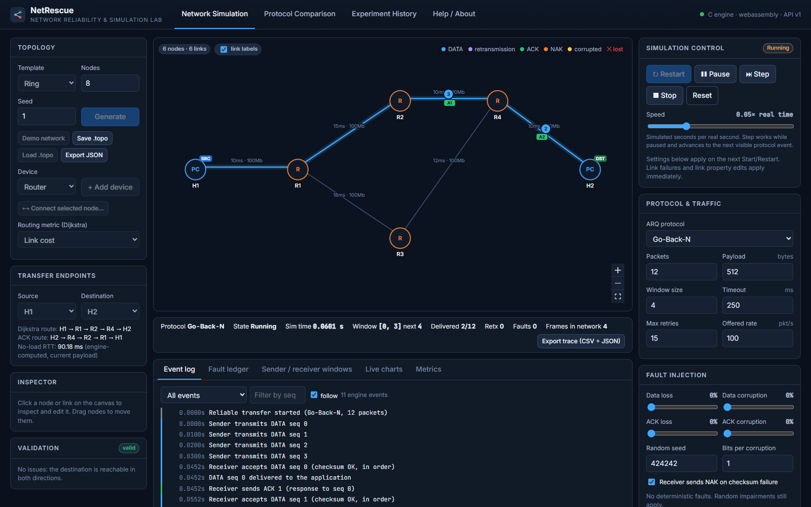
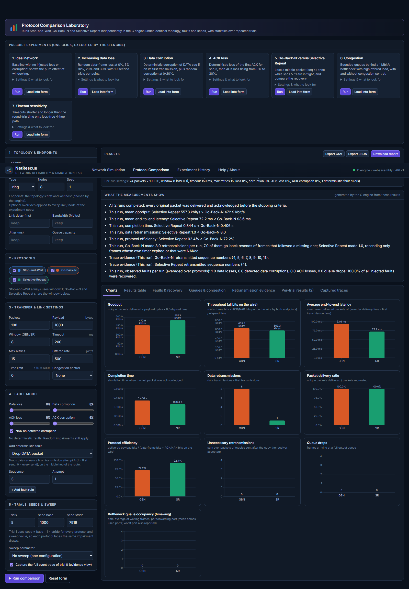

# NetRescue — Network Reliability and Simulation Lab

NetRescue is a network simulation lab whose **entire simulation core is written in C** (C11) and whose
user interface is a **React + TypeScript website**. The C engine is compiled to **WebAssembly** with
Emscripten and runs inside a Web Worker in the browser; the website only draws what the engine returns.

| Layer | Language | What it does |
|---|---|---|
| Simulation engine (`src/`, `include/`) | **C11** | Graph, topology generators, Dijkstra routing, hop-by-hop discrete-event packet simulation, bounded queues, link delay/bandwidth/jitter, Stop-and-Wait / Go-Back-N / Selective Repeat, checksums, fault injection, congestion control, metrics, experiment runner with statistics, presets, save/load, CSV export, JSON API |
| Bridge | C → WebAssembly | `nr_api_call(json)` is the only function the website calls |
| Website (`web/`) | React, TypeScript, Vite, React Flow, Recharts | Topology editor, controls, animation, charts, tables, exports |



## Features

**Mode A — Network Simulation lab**
- Generate line, bus, star, ring, tree, full-mesh, hybrid and seeded-random topologies; add/delete/move hosts, routers, switches, servers and access points; connect nodes; edit bandwidth, delay, jitter, per-link loss, routing cost, direction and queue capacity; fail/recover nodes and links (also mid-transfer); save/load `.topo` files; validation of disconnected networks and unreachable endpoints.
- Configure protocol, packet count, payload, window, timeout, retry limit, offered rate, seed, the four impairment probabilities, NAK, corruption burst size, congestion control, cross traffic and a time limit.
- Deterministic fault rules: drop/corrupt DATA seq *N* on attempt *A*, drop/corrupt the *A*-th ACK for seq *N*, burst loss, temporary link outage, forced queue overflow.
- Start / Pause / Resume / Stop / Reset, speed control (0.01×–5× real time) and **single-event stepping**.
- Live animation of DATA, retransmissions, ACK/NAK, corrupted frames and losses on the actual Dijkstra route; queue occupancy at routers; sender/receiver sliding windows; event log; fault ledger (time, frame, node/link, fault type, detected?, protocol response, recovered?); live charts; metrics; trace export (CSV + JSON).

**Mode B — Protocol Comparison laboratory** (separate page)
- Fair runner in C: same topology, endpoints, packets, payload, links, queues, fault model and seed schedule for every protocol; all state is rebuilt for every run.
- Single-run comparison or repeated trials with mean, sample standard deviation and Student-t 95 % confidence intervals; sweeps over loss, corruption, ACK loss/corruption, timeout, window, rate, queue size, delay, bandwidth, jitter, congestion mode or payload.
- Seven one-click prebuilt experiments (ideal network, increasing loss, corruption, ACK loss, Go-Back-N vs Selective Repeat, congestion, timeout sensitivity).
- Results table, bar/line charts with error bars, fault & recovery and queue/congestion tables, retransmission evidence (exact sequence numbers), per-trial table, captured event traces, findings generated by the C engine from the measurements, CSV / JSON / HTML-report export, and an experiment history.



## Quick start on Windows (just run the website)

The repository already contains the compiled WebAssembly engine (`web/src/engine/generated/`), so only Node.js is needed.

1. Install **Node.js 20 or newer (LTS)** from <https://nodejs.org>.
2. Open a Command Prompt in the project folder and run:
   ```bat
   start-website.bat
   ```
   or manually:
   ```bat
   cd web
   npm install
   npm run dev
   ```
3. Open <http://localhost:5173>. The badge in the top-right corner shows `C engine · webassembly · API v1` when the engine has loaded.

For a production build: `cd web`, `npm run build`, `npm run preview` (serves `web/dist` at <http://localhost:4173>). Browsers do not allow WebAssembly workers from `file://`, so always open the site through one of these servers.

## Building the C engine natively (Windows)

Needed for the C tests, the CLI tools, the original Win32 dashboard, and to cross-check the WebAssembly build.

**Tools:** CMake 3.16+ and either Visual Studio Build Tools (MSVC) or MinGW-w64 gcc (e.g. `winget install BrechtSanders.WinLibs.POSIX.UCRT`).

```bat
build.bat
```
`build.bat` picks MSVC when `cl` is on PATH (Developer Command Prompt), otherwise MinGW, then builds and runs all C tests. Equivalent manual commands with MinGW:
```bat
cmake -S . -B build -G "MinGW Makefiles" -DCMAKE_BUILD_TYPE=Release
cmake --build build --parallel
ctest --test-dir build --output-on-failure
```
With MSVC: `cmake -S . -B build` then `cmake --build build --config Release` and `ctest --test-dir build -C Release --output-on-failure`.

Executables in `build\` (or `build\Release\` with MSVC):

| Program | Purpose |
|---|---|
| `NetRescue.exe` | Original Win32/GDI desktop dashboard (kept, ported to the new engine) |
| `NetRescueCLI.exe` | Routing demo; `--list-presets`; `--preset gbn_vs_sr` runs a prebuilt experiment and prints the table and findings |
| `netrescue_api.exe` | Native host of the website's JSON API: one JSON request per line on stdin → one response per line (C-backend fallback and scripting tool) |
| `test_core.exe`, `test_engine.exe`, `test_api.exe` | C test suites |

Example: `echo {"cmd":"run_preset","id":"gbn_vs_sr"} | build\netrescue_api.exe`

## Rebuilding the WebAssembly engine (only after changing C code)

1. Install the Emscripten SDK once:
   ```bat
   git clone https://github.com/emscripten-core/emsdk.git %USERPROFILE%\emsdk
   cd %USERPROFILE%\emsdk
   emsdk install latest
   emsdk activate latest
   ```
2. From the project folder:
   ```bat
   powershell -ExecutionPolicy Bypass -File scripts\build-wasm.ps1
   ```
   (pass `-Emsdk C:\path\to\emsdk` if it is elsewhere). This compiles the same 11 C modules into `web\src\engine\generated\netrescue_engine.mjs` + `.wasm`. Alternatively: `emcmake cmake -S . -B build-wasm && cmake --build build-wasm`.

This project was built and verified with Emscripten 6.0.12.

## Using the website

**Configure a topology:** pick a template, node count and seed and press *Generate*, or *Demo network*. Add devices, select a node and press *Connect selected node…* then click the peer. Click a node or link to edit it in the Inspector; drag nodes to move them. Choose source and destination under *Transfer endpoints*; the engine shows the Dijkstra route, the ACK route and the no-load RTT. *Validation* lists errors (e.g. unreachable destination) that block a start.

**Introduce errors:** in *Fault injection* set data loss, data corruption, ACK loss and ACK corruption probabilities, and add deterministic rules (e.g. “Drop DATA packet, sequence 3, attempt 1”). In the Inspector set a per-link loss probability or press *Fail link* during a transfer. In *Queues & congestion* lower queue sizes, add cross traffic, or pick a congestion controller.

**Run the protocols:** choose Stop-and-Wait, Go-Back-N or Selective Repeat in *Protocol & traffic* and press *Start*. Use the speed slider (0.05× is good for watching), *Pause* and *Step*. Watch the *Event log*, *Fault ledger*, *Sender / receiver windows*, *Live charts* and *Metrics* tabs. *Export trace* downloads the engine's event trace (CSV) and run summary (JSON).

**Comparison mode:** open *Protocol Comparison*. Press *Run* on a prebuilt experiment, or *Load into form* to adapt it, or fill in the form (topology, protocols, settings, fault model, trials, seed base/stride, sweep) and press *Run comparison*.

**Export results:** in the results header use *Export CSV* (one row per engine run, written by C), *Export JSON* (the complete engine result) or *Download report* (standalone HTML). Every run is also kept under *Experiment History*, which can re-open, export or import results.

## Tests

| Suite | Command | What it covers |
|---|---|---|
| C: `core` | `ctest --test-dir build` | the original regression tests (graph, routing, packets, CIDR, persistence, topologies, ARQ basics, congestion) |
| C: `engine` | ″ | all protocols, window limits, GBN-vs-SR middle loss, corruption + NAK/timeout recovery, ACK loss/corruption, duplicates, retry and time limits, burst loss, link outage, queue overflow, congestion control, random faults, metric formulas checked against the event trace, reproducibility, run isolation, statistics, presets, CSV, validation, save/load |
| C: `api` | ″ | JSON parser/writer and every API command as the website calls it |
| Web: unit + integration | `cd web` then `npm test` | the WebAssembly engine in Node (protocol evidence, reproducibility, CSV), **byte-identical results between WebAssembly and native builds**, UI controls driving the real engine, results rendering |
| Web: end-to-end | `cd web`, `npm run build`, `npm run e2e` | headless Edge/Chrome drives the built site: live transfer, deterministic loss, presets, exports, history; screenshots in `web/e2e-output/` |

## Documentation

- [docs/teacher-demo.md](docs/teacher-demo.md) — step-by-step demonstration script
- [docs/viva-guide.md](docs/viva-guide.md) — viva questions and answers
- [docs/metrics.md](docs/metrics.md) — every metric with its formula
- [docs/fault-injection.md](docs/fault-injection.md) — how errors are introduced and recorded
- [docs/architecture.md](docs/architecture.md), [docs/algorithms.md](docs/algorithms.md), [docs/api.md](docs/api.md)
- [docs/testing.md](docs/testing.md) — test inventory and verification results
- [docs/CHANGES.md](docs/CHANGES.md) — modified files and architecture decisions

## Limitations

- One reliable transfer is simulated at a time (plus optional constant-rate cross traffic on the first forwarding hop). Sequence numbers are not wrapped modulo 2^k.
- The data-frame header is modelled as protected by the link layer, so corruption hits the payload and the receiver can NAK the correct sequence number.
- Congestion control is educational AIMD (rate-based on explicit queue-overflow signals, or window-based on timeouts), not TCP.
- The bus topology is modelled as a chain of point-to-point links, not a shared medium.
- The engine has fixed capacities: 64 nodes, 256 links, 1024 packets per transfer, 256-frame queues, 4000 runs per experiment.
